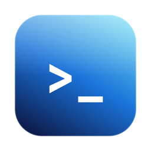

<p align="center"></p>

# XTerm

A macOS terminal with Apple's Liquid Glass look. It behaves like Terminal.app (your shell, colors, vim, tmux, scrollback, copy/paste, tabs); only the style is new.

Requires macOS 26 (Tahoe) or later.

## Install

```sh
brew install --cask bythebug/tap/xterm-glass
```

XTerm isn't notarized by Apple yet, so the first launch is blocked. Allow it once with:

```sh
xattr -dr com.apple.quarantine /Applications/XTerm.app
```

## Build from source

Needs Xcode 26+.

```sh
swift run          # run it directly
./bundle.sh        # build XTerm.app
cp -R XTerm.app /Applications/
```

## How it works

- `Sources/XTerm/XTermApp.swift` — the window: hidden title bar, glass edge to edge.
- `Sources/XTerm/GlassTerminal.swift` — native `NSGlassEffectView` behind a transparent [SwiftTerm](https://github.com/migueldeicaza/SwiftTerm) terminal, plus the color palette. Tweak `tintColor` for more or less glass.
- `bundle.sh` — packages the `.app` with its icon and Info.plist.

## Credits

Developed by Suraj Van Verma. Terminal emulation by [SwiftTerm](https://github.com/migueldeicaza/SwiftTerm) (MIT).
